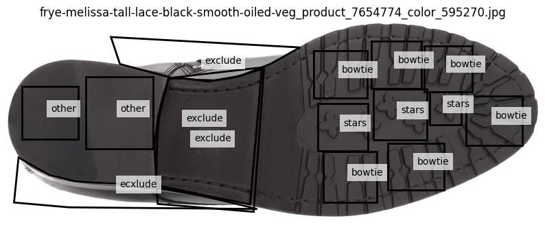
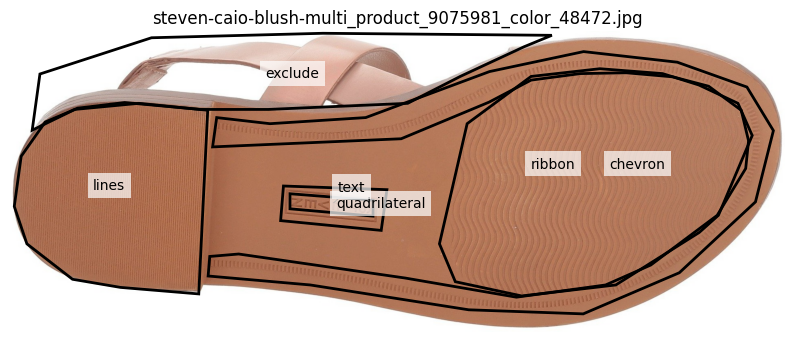

# 1 Introduction

# 2 FasterRCNN

maximum number of detections = 100


IoU 

### Metrics

#### Training metrics

Average training loss
Average precision

#### Evaluation metric
AP@[0.50:0.95] Average of AP at 10 IoUs 0.50-0.95, step=0.05
AP50
AP75
AP_small
AP_medium
AP_large


#### Evaluation metrics


# 3 Experiment Setup

## 3.1 Data

### Annotation

Our initial 4144 image data came from online retail listing of shoes by scraping. These images are stored in RGB format, and were annotated in XML format using an annotation tool LabelMe @labelme @annotations. Characteristics were enclosed by polygons (@fig-annotation) or boxes (@fig-annotation2). 17 labels were use to annotate class characteristics: circle, triangle, quadrilateral, rectangle, pentagon, hexagon, octagon, line, bowtie, star, text, logo, ribbon, chevron, polygon, heel, exclude. The "exclude" category labels the region not belonging to the sole.

::: {#fig-annotations layout-ncol="2"}
{#fig-annotation}

{#fig-annotation2}

Annotation examples
:::

#### Bounding boxes [Need two imgs]

Since Faster R-CNN uses rectangle bounding boxes for object localization, the polygon annotations were converted into bounding boxes by using the smallest axis-aligned rectangle enclosing each polygon. Although it may introduce additional background information, Faster R-CNN does not train on pixel-level annotations.

<!-- 扩大背景，IoU改变，也许影响判定？ -->

In the original annotation, some bounding boxes/polygons were annotated with multiple labels, we split into individual annotations. For example, [AN IMAGE!!!!], the bounding box was annotated by both CLASS A AND CLASS B, the annotation was ended up two identical bounding boxes, and assigned with label A and label B. This approach increased the number of samples in the dataset, but it also introduced ambiguity in the association between visual features and class labels.


#### Class

Comparing the objects labeled as "exclude" from the two images in @fig-annotation. The "exclude" class was removed in the subsequent training and testing for its ambiguous definition. The remaining 16 labels exhibited class imbalance, as shown in @fig-class-distribution. Among the 16 labels, "polygon", "octagon", "rectangle", and "heel" were underrepresented where they have 12, 10, 4, and 2 annotations, respectively. To address the limited sample in the classes, "rectangle" annotations were merged into the "quadrilateral" class because they are a specific type of quadrilateral. The classes "heel" and "polygon" were removed because the limited number and lack of specificity. The class "octagon" was retained to maintain consistency in the classification scheme, as it represents a distinct geometric shape and polygons with fewer sides were also annotated as separate classes.

```{r, echo=FALSE, warning=FALSE, message=FALSE}
#| label: fig-class-distribution
#| fig-cap: "Number of annotations per class"

library(ggplot2)
library(tidyverse)

df <- data.frame(
  class = c(
    "quadrilateral", "line", "circle", "logo", "hexagon",
    "polygon", "star", "chevron", "ribbon", "bowtie",
    "pentagon", "triangle", "heel", "octagon",
    "rectangle", "text"
  ),
  count = c(
    2134, 1692, 2143, 616, 478,
    12, 647, 2094, 180, 666,
    131, 1154, 2, 10,
    4, 2727
  )
)
df <- df %>% arrange(desc(count))
df %>% 
  ggplot() +
  geom_col(aes(y=reorder(class, count), x=count), fill="steelblue") +
  theme(
    axis.text.y = element_text(size=10),
    plot.title = element_text(size = 18, hjust = 0.5)
  )+
  labs(title = "Number of Annotations per Class",
       y = "Class")
```

### COCO @coco format conversion

In the dataset, objects sizes vary within the same class, so they annotations were converted into COCO format for detection performance evaluation. AP@[0.50:0.95], AP50, AP75, AP_small, AP_medium, AP_large were evaluated and recorded.

### Data split

The total number of 4144 data were divided into three datasets: training set, validation set, and test set. The training set took 70% of the data, the validation set took 20% of the data, and the test set took 10% of the data. Hence, there were 2983 images in the training set, 746 images in the validation set, and 415 in the test set. A hold-out validation approach was adopted for hyperparameter tuning and model selection. The training set was used to train the models, while the validation set was used to evaluate their performance to identify the best-performing weights. In the weights optimization, the weights achieving the highest validation AP was retained.

## Implementation

The Faster R-CNN model was implemented using the PyTorch tochvision library, with default ResNet-50 as the backbone. The model train followed a transfer learning paradigm, where the model was initialized with weights pretrained on the COCO dataset. The original classification and bounding box regression predictors were adapted to accommodate the footwear dataset with randomized weights. The remain architecture followed the default from torchvision. 


To identify the best detection performance, a grid search was conducted. Nine runs were performed using combinations of three learning rates (0.0005, 0.001, 0.0025, and 0.005) and three weight decay values (0, 0.0001, 0.0005) on a computing cluster with a NVIDIA V100 GPU. Prioritizing learning rate and weight decay as two training hyperparameters because they control parameter optimization and regularization, respectively @hyperparameter. The learning rate of 0.0025 and the weight decay of 0.0001 were selected following the torchvision recommendation according to the batch size and the optimizer used @hyperparameter_py. The rest learning rates were considered by scaling the recommended learning rate. In each run, the model was trained for 80 epochs with a SGD optimizer and a batch size of 2 on the same training and validation set. No transformation or data augmentation was applied in the training. In the inference, a maximum of 100 detections per image was adopted. The average training loss was recorded at each epoch to monitor the training process. Model performance was evaluated on the validation set using COCO AP, averaged over IoU threshold from 0.5 to 0.95. The model weights achieving the highest validation AP were saved as the best model for that hyperparameter configuration After nine runs, the optimal model is finalized by comparing the AP values. In addition to the AP, AP50, 
[NEED A DIAGRAM HERE] 


\newpage
# Reference
